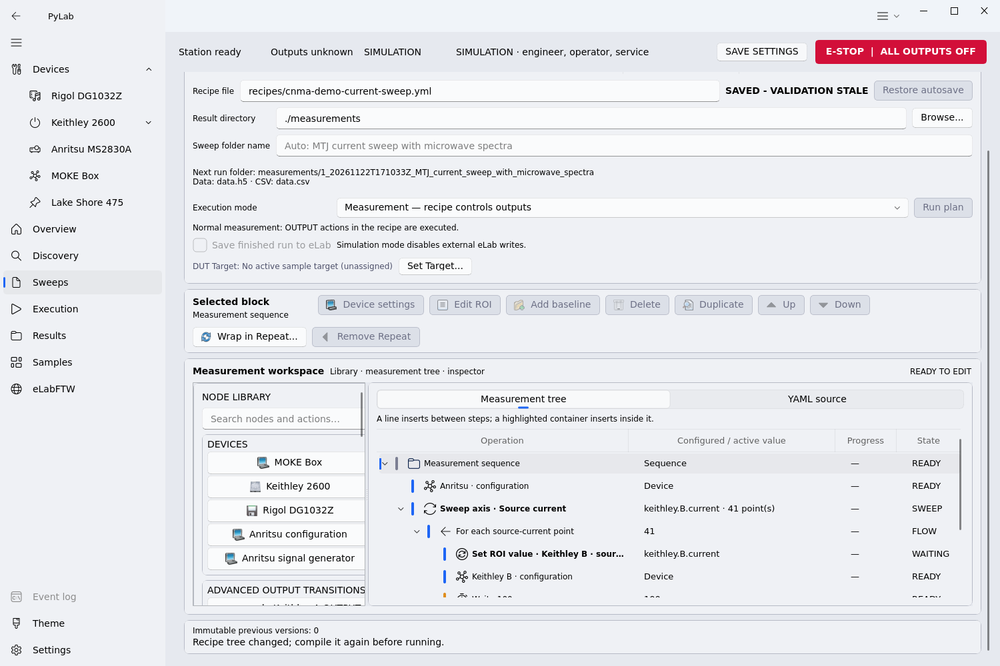
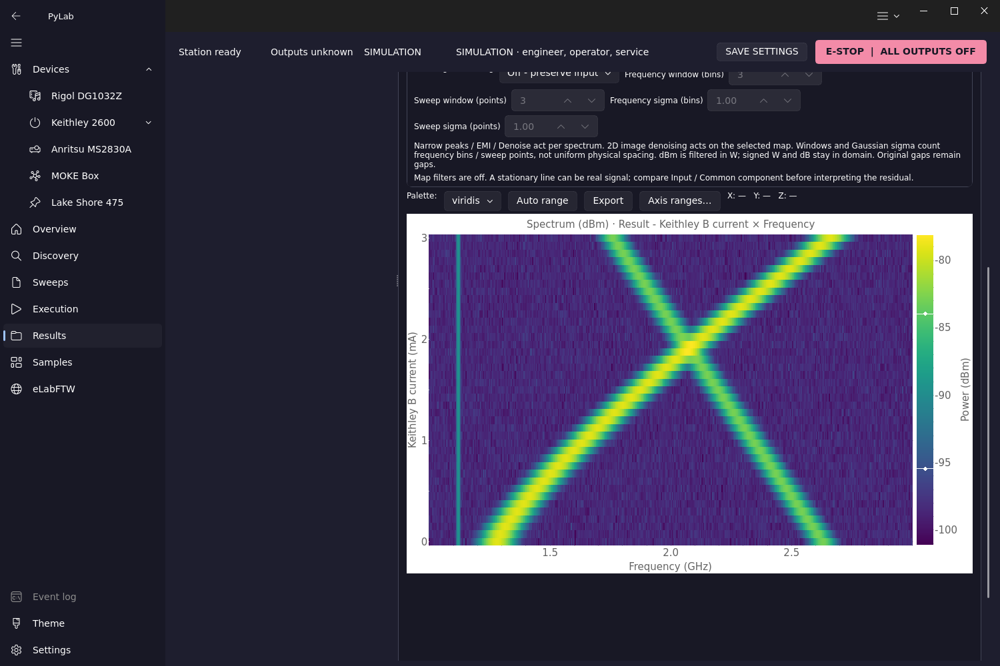

# MTJLAB

**Automated measurement software for magnetic tunnel junctions and spin-torque nano-oscillators.**

<p>
  <a href="https://cordis.europa.eu/project/id/101208951">
    <picture>
      <source media="(prefers-color-scheme: dark)" srcset="docs/branding/eu-funded-en-inverted.png">
      
    </picture>
  </a>
  &nbsp;&nbsp;
  <a href="https://rptu.de/en/">
    <picture>
      <source media="(prefers-color-scheme: dark)" srcset="docs/branding/rptu-inverted.svg">
      
    </picture>
  </a>
</p>

MTJLAB brings instrument control, sweep design, live acquisition and offline
analysis into one PySide6 Fluent desktop application. It supports electrical
and microwave characterization for the [CNMA project](#funding) at RPTU
Kaiserslautern-Landau.

[Quick start](#quick-start) · [Screenshots](#screenshots) ·
[Instruments](#instruments) · [Data and analysis](#data-and-analysis) ·
[Citation and affiliation](#citation-and-affiliation)

[](https://github.com/MateuszZelent/MTJLAB/actions/workflows/ci.yml)
[](LICENSE)

## Quick start

From the repository root, use [uv](https://docs.astral.sh/uv/) to install the
locked environment and open the application with simulated instruments.

```bash
git clone https://github.com/MateuszZelent/MTJLAB.git
cd MTJLAB
uv sync --locked --python 3.14
uv run --locked --python 3.14 python -m app.main --simulate
```

With an active Python virtual environment, you can also install the package
with `python -m pip install -e .` and launch it with `lab-control --simulate`.
The default station profile is `.config/settings.yml`. Use
`--settings <path>` to choose a separate profile.

Open **Sweeps** to build or load a [YAML recipe](recipes/). Preflight checks
units, parameter bounds and the execution plan before a run. **Execution**
shows progress and instrument events. **Results** opens saved files for
inspection without connecting to instruments.

## Screenshots

The screenshots show PyLab, the MTJLAB desktop application, in simulation mode.
The heatmap uses a synthetic HDF5 dataset.



*Sweeps workspace with a Keithley current axis and Anritsu spectrum acquisition.*



*Results heatmap of synthetic microwave spectra across the current sweep.*

## Instruments

| Instrument | Role |
| --- | --- |
| Keithley 2600 series | Dual-channel source-measure unit for current and voltage sourcing, compliance and readback |
| Rigol DG1000Z, including DG1032Z | Function generator for waveform excitation and pulsing |
| Anritsu MS2830A | Microwave spectrum acquisition, live spectra and spectrograms |
| Lake Shore Model 475 | Read-only magnetic-field measurements |
| MOKE Box | Station-specific acquisition and output control with field calibration |

For hardware operation, configure and qualify the station profile, instrument
identities, sample limits and physical interlocks before enabling outputs.
Launch with `uv run --locked --python 3.14 lab-control --settings <path>` and follow the
[operator procedure](docs/PROCEDURA_OPERATORA.md) and
[hardware qualification guide](docs/HIL_QUALIFICATION.md).
The software E-STOP shortcut is `Ctrl+Shift+E`. Keep the physical interlock
available for independent shutdown.

## Data and analysis

- Versioned YAML recipes define nested sweeps, device actions and final output
  states. The compiled plan carries a content hash.
- HDF5 run files record acquisition data alongside the recipe, station settings,
  device identities and checkpoint metadata. The public layout supports
  PyThat and thaTEC:OS readers.
- The Results workspace compares scalar readings, spectra and heatmaps along
  recorded sweep coordinates. Analysis can apply reference correction and
  filters while retaining the acquired input.
- The sample catalogue organizes results by device or sample. The optional
  eLabFTW integration can associate selected run artifacts with lab notebook entries.

## Development

```bash
uv sync --locked --python 3.14 --extra dev
uv run --locked --python 3.14 --extra dev pytest
```

The recipe schema lives in [`app/recipes/`](app/recipes/), with compilation and
execution in [`app/engine/`](app/engine/). Instrument adapters are in
[`app/devices/`](app/devices/), storage in [`app/storage/`](app/storage/)
and the desktop interface in [`app/ui/`](app/ui/).
See the [device module guide](docs/NEW_DEVICE_MODULES.md),
[engineering notes](docs/engineering/) and [audits](docs/audits/).

<!-- mtjlab-version-dashboard:start -->
<a id="version-dashboard"></a>

<details>
<summary>Version and compatibility dashboard</summary>

These versions and ranges are declared in [`pyproject.toml`](pyproject.toml).
See [`uv.lock`](uv.lock) for the resolved environment.

| Component | Declared version or range |
| --- | --- |
| MTJLAB | `0.1.0` |
| Python | `>=3.11` |
| PySide6 and Fluent Widgets | `>=6.7` and `1.11.2` |
| NumPy and PyQtGraph | `>=1.26` and `>=0.13.7,<0.14` |
| h5py and PyThat | `>=3.11` and `0.2.14` |
| PyVISA and Lake Shore | `>=1.14` and `1.10.0` |
| Pydantic and ruamel.yaml | `>=2.7,<3` and `>=0.18` |

Regenerate the table after updating the manifest.

```bash
python tools/update_readme_version_dashboard.py --write
```

</details>
<!-- mtjlab-version-dashboard:end -->

## Citation and affiliation

**Mateusz Zelent** · Fachbereich Physik and Landesforschungszentrum OPTIMAS,
Rheinland-Pfälzische Technische Universität Kaiserslautern-Landau (RPTU),
67663 Kaiserslautern, Germany. [RPTU author profile](https://physik.rptu.de/ags/hillebrands/members/dr-mateusz-zelent)

Cite *MTJLAB: Automated measurement software for spintronics* using
[`CITATION.cff`](CITATION.cff) and include the exact software release or
Git commit used in your analysis.

## Funding

MTJLAB supports the experimental work of **CNMA**, *Chiral Non-stationary
Magnonic Auto-oscillator for neuromorphic computing*, hosted at RPTU
Kaiserslautern-Landau. CNMA is funded by the European Union through
Horizon Europe Marie Skłodowska-Curie Actions (MSCA) Postdoctoral Fellowships
under Grant Agreement No. **101208951**. [CORDIS project record](https://cordis.europa.eu/project/id/101208951)

The views and opinions expressed are solely those of the author and do not
necessarily reflect those of the European Union or the European Research
Executive Agency (REA). Neither the European Union nor REA can be held
responsible for them.

## License

MTJLAB is licensed under [GPL-3.0-or-later](LICENSE).
See [third-party notices](THIRD_PARTY_NOTICES.md) for dependencies and branding assets.
